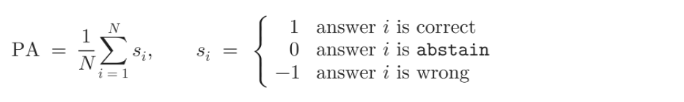
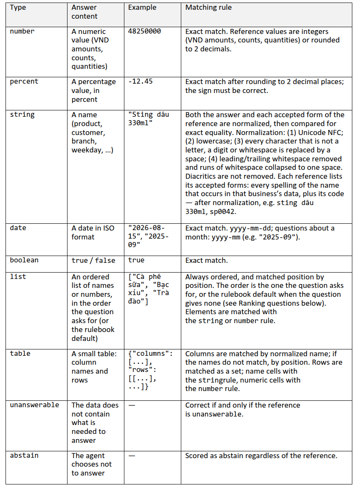

# TRACK 2: DATAMATE — ĐẶC TẢ KỸ THUẬT & TOÀN BỘ 10 ĐIỀU KHOẢN RULEBOOK CHÍNH THỨC
### Phiên bản tối ưu cho Codex, Claude & Antigravity (AGY) — Mô hình tự do, tập trung tối đa kết quả

Tài liệu này là cẩm nang đặc tả kỹ thuật, logic kinh doanh nghiệp vụ và quy chế chấm điểm chuẩn xác 100% cho **Track 2: DataMate** tại Zalo AI Challenge 2026, được trích xuất trực tiếp từ Rulebook chính thức và công thức metric của Ban tổ chức.

---

## 1. TỔNG QUAN BÀI TOÁN & CƠ CHẾ ĐIỂM SỐ (PENALIZED ACCURACY)

* **Bản chất**: Xây dựng AI Agent có khả năng trả lời các câu hỏi phân tích dữ liệu kinh doanh bằng tiếng Việt dựa trên dữ liệu bảng phức tạp, lộn xộn (CSV, Excel đa sheet, SQLite) xuất từ phần mềm bán hàng của các hộ kinh doanh/tiểu thương Việt Nam.
* **Quy tắc trích xuất dữ liệu**:
  - Mọi câu trả lời bắt buộc phải được tính toán từ **dữ liệu phát hành** và file `calendar.csv`.
  - Tuyệt đối không dùng tri thức bên ngoài. Nếu dữ liệu không có thông tin thì xem là `unanswerable`, không tự suy đoán.
* **Công thức chấm điểm Penalized Accuracy (PA)** ([`datamate_formula_1.png`](extracted_images/datamate_formula_1.png)):



  $$\text{PA} = \frac{1}{N} \sum_{i=1}^N s_i, \quad s_i = \begin{cases} 
  +1, & \text{câu trả lời } i \text{ ĐÚNG} \\ 
  0, & \text{câu trả lời } i \text{ là } \textbf{abstain} \\ 
  -1, & \text{câu trả lời } i \text{ SAI} 
  \end{cases}$$

### Phân tích kỳ vọng toán học & Chiến lược "Silence is Free"
* Kỳ vọng điểm số khi chọn Trả lời với độ tin cậy $p$:
  $$E[s] = p \cdot (+1) + (1 - p) \cdot (-1) = 2p - 1$$
* Ngưỡng hòa vốn lý thuyết: $2p - 1 > 0 \iff p > 0.5$ (50%).
* **Ngưỡng an toàn thực chiến**: Do mô hình LLM thường bị thừa tự tin (overconfident), Agent chỉ nên xuất đáp án khi độ tin cậy thực nghiệm **$p \ge 0.70$** (hoặc code thực thi thành công không lỗi). Nếu code crash hoặc dữ liệu mâu thuẫn $\implies$ Kích hoạt ngay **`{"type": "abstain"}`** để nhận **0 điểm**, bảo toàn điểm số trước án phạt trừ 1 điểm (-1).

---

## 2. CẤU TRÚC DỮ LIỆU ĐẦU VÀO (INPUT SPECIFICATION) & BỘ DỮ LIỆU KAGGLE

Bộ dữ liệu chính thức được lưu trữ tại Kaggle: [thanhkhil/zaloai-datamate-dataset](https://www.kaggle.com/datasets/thanhkhil/zaloai-datamate-dataset).

### 2.1. Cấu trúc thư mục
```text
<split>/ (train, public_test, private_test)
├── questions.jsonl                 # Danh sách câu hỏi cần trả lời
├── answers.jsonl                   # (Chỉ có ở train): Nhãn chuẩn và alias chấp nhận
├── calendar.csv                    # Bảng đối chiếu dương lịch - âm lịch
└── data/                           # Dữ liệu bảng của từng doanh nghiệp
    ├── <business_id>/              # (Train: biz_101..biz_130; Public Test: dev_001..dev_014)
    │   ├── README.md               # Mô tả ngành nghề, quy ước, bảng quy đổi đơn vị
    │   ├── *.xlsx / *.csv / *.sqlite # Các sổ bán hàng, nhập hàng, công nợ, danh mục
```

### 2.2. Chi tiết từng tệp dữ liệu
1. **`questions.jsonl`**:
   - Mỗi dòng là 1 đối tượng JSON đại diện cho 1 câu hỏi:
     ```json
     {"id": "q_06de33fa21cc", "business_id": "biz_118", "question": "sp bán dc nhiều nhất tuần rồi là gì", "as_of_date": "2026-03-04"}
     ```
   - `id`: Mã định danh câu hỏi (dùng để xuất vào `submission.jsonl`).
   - `business_id`: Thư mục dữ liệu tương ứng trong `data/<business_id>/`.
   - `question`: Câu hỏi bằng tiếng Việt tự nhiên của chủ shop / nhân viên.
   - `as_of_date`: Mốc thời gian "Hôm nay" (`YYYY-MM-DD`). Mọi dữ liệu sau ngày này xem như chưa xảy ra!
2. **`answers.jsonl`** (Tập Train):
   - Chứa nhãn đúng và danh sách các cách biểu diễn được chấp nhận (`alias`):
     ```json
     {"id": "q_06de33fa21cc", "type": "string", "answer": "Xi măng Hà Tiên PCB40 bao 50kg", "alias": ["SP0001"]}
     ```
3. **`calendar.csv`**:
   - Gồm các cột: `date` (YYYY-MM-DD), `lunar_day`, `lunar_month`, `lunar_year`, `is_leap_month`.
   - Bắt buộc dùng để tra cứu các mốc thời gian âm lịch (như Mùa Tết: từ 23 Chạp năm trước đến mùng 10 Giêng năm nay).
4. **`data/<business_id>/README.md`**:
   - Chứa thông tin cực kỳ quan trọng:
     - Giới hạn ngày dữ liệu phát hành (`Dữ liệu có đến hết YYYY-MM-DD`).
     - Bảng quy đổi đơn vị (ví dụ: `1 thùng = 24 lon`, `1 lốc = 6 lon`, `1 bao = 25 kg`).
     - Ý nghĩa các cột và trạng thái của từng file Excel/CSV.

---

## 3. TOÀN BỘ 10 ĐIỀU KHOẢN RULEBOOK CHÍNH THỨC CỦA BAN TỔ CHỨC

Mọi đáp án chuẩn của Ban tổ chức đều được tính toán nghiêm ngặt theo 10 điều khoản dưới đây:

### Mục 1: Đơn Hàng và Doanh Thu
1. **Đơn tính vào doanh thu**: Chỉ tính các đơn **không huỷ** và **không trả hàng**.
   * ⚠️ **Quy tắc Trả hàng một phần**: Đơn có trả hàng, **kể cả chỉ trả một phần**, bị coi là đơn trả hàng $\implies$ **BỎ TOÀN BỘ CẢ ĐƠN KHỎI DOANH THU**.
   * ⚠️ **Đơn đang giao**: Đơn có trạng thái `đang giao` **VẪN ĐƯỢC TÍNH VÀO DOANH THU**.
2. **Bán được bao nhiêu tiền / Thu về bao nhiêu tiền**: Là **doanh thu** theo mục này, không phải số tiền khách thực tế đã thanh toán.
3. **Kỳ của đơn**: Xác định theo **ngày đặt hàng** (`order_date`), không theo ngày giao hàng hay ngày thu tiền.
4. **Đơn bị huỷ**: Là đơn có trạng thái `huỷ`. Đơn trả hàng **không** phải là đơn huỷ.
5. **Số đơn**: Chỉ đếm đơn không huỷ, không trả (kể cả khi đếm số đơn có 1 mặt hàng hoặc số đơn của 1 khách).
6. **Doanh thu một đơn**: Bằng **tổng thành tiền các dòng hàng** (đã trừ giảm giá/chiết khấu trên từng dòng hàng).
   * ⚠️ **KHÔNG trừ giảm giá trên cả đơn** (voucher khuyến mãi tổng tiền, voucher shop).
   * ⚠️ **KHÔNG cộng thuế VAT**.
   * ⚠️ **KHÔNG bao gồm phí giao hàng (shipping fee)**.
7. **Hình thức thanh toán**: Xác định theo hình thức ghi trên đơn (không theo lần trả nợ về sau). Đơn ghi nợ không tính vào tiền mặt/chuyển khoản. **Đơn COD là hình thức riêng**, không tính vào tiền mặt.
8. **Nhóm khách hàng**: Đơn không ghi tên khách (khách vãng lai) **không thuộc nhóm nào** (kể cả nhóm `lẻ`). Tỉ trọng doanh thu của nhóm chia cho doanh thu **cả shop** cùng kỳ (mẫu số có tính cả đơn khách vãng lai).
9. **Tỉ lệ đơn huỷ trong kỳ**: Bằng:
   $$\text{Tỉ lệ huỷ} = \frac{\text{Số đơn huỷ trong kỳ}}{\text{Tổng mọi đơn đặt trong kỳ (cả hoàn thành, huỷ, trả hàng, đang giao)}} \times 100\%$$
   *(Làm tròn 2 chữ số thập phân)*.
10. **Phần trăm tăng trưởng / thay đổi**: So với kỳ liền trước; nếu giảm ra **số âm**.
11. **Chênh lệch / Tăng giảm (số tiền, số lượng)**: Bằng $Kỳ\_hỏi - Kỳ\_so$ (nếu ít hơn ra số âm).

---

### Mục 2: Thời Gian & Mốc Tham Chiếu `as_of_date`
1. **Hôm nay**: Là giá trị trong trường `as_of_date` của câu hỏi (`questions.jsonl`). Mọi bản ghi có ngày sau `as_of_date` coi như **chưa xảy ra** (ngoại trừ trạng thái huỷ/trả hàng ghi trên đơn vẫn được ghi nhận).
2. **Tháng này / Tháng trước**:
   * *Tháng này*: Từ ngày 01 của tháng chứa `as_of_date` đến hết ngày `as_of_date`.
   * *So với tháng trước*: So sánh với **cùng số ngày** của tháng trước (từ ngày 01 đến ngày trùng với ngày của `as_of_date` trong tháng trước).
3. **N ngày gần nhất**: Bao gồm cả ngày hôm nay (`as_of_date`) và $N-1$ ngày trước đó.
4. **Tuần**: Tuần bắt đầu từ thứ Hai và kết thúc vào Chủ Nhật.
5. **Mùa Tết**: Tính từ ngày 23 tháng Chạp (âm lịch năm trước) đến hết mùng 10 tháng Giêng (âm lịch năm sau). Bắt buộc tra cứu qua `calendar.csv`.

---

### Mục 3: Xếp Hạng & Sản Phẩm Bán Chạy
1. **Bán chạy nhất / Hot nhất**: Xếp theo **TỔNG SỐ LƯỢNG ĐÃ ĐỔI RA ĐƠN VỊ CƠ BẢN** (`sum(quantity_base)`), **KHÔNG** xếp theo doanh thu tiền hay số lần xuất hiện trên hóa đơn.
2. **Quy tắc Tie-breaking khi bằng số lượng**: Nếu hai mặt hàng có cùng số lượng bán ra, ưu tiên mặt hàng có **mã sản phẩm (product_id) nhỏ hơn theo thứ tự từ điển (alphabetical)**.
3. **Phí phục vụ / Phí ship**: KHÔNG phải là sản phẩm (không tính vào danh sách bán chạy, không đếm là mặt hàng).

---

### Mục 4: Công Nợ & Khách Hàng
1. **Nợ của khách hàng**: Bằng phần chưa thanh toán của tổng giá trị các đơn hàng (CÓ trừ voucher shop, CÓ GỒM PHÍ SHIP, và CÓ TÍNH CẢ ĐƠN TRẢ HÀNG nếu đơn đó vẫn còn ghi nhận nợ).
2. **Khách nợ**: COD và sàn thương mại điện tử **KHÔNG** được xem là khách nợ. Tuổi nợ tính từ ngày đặt hàng.

---

### Mục 5: Giá Vốn & Lãi Gộp (Gross Profit)
1. **TUYỆT ĐỐI CẤM TÍNH FIFO, CẤM LẤY GIÁ NHẬP LẦN CUỐI**:
   * Giá vốn của từng dòng bán ra = $Số\_lượng \times Giá\_vốn\_ghi\_trên\_chính\_dòng\_bán\_đó$.
   * **CẤM** tự tính lại từ phiếu nhập kho.
2. **Lãi gộp (Gross Profit)** = $Doanh\_thu\_dòng\_bán - Giá\_vốn\_dòng\_bán$.

---

### Mục 6: Đặc Thù Ngành Nghề
1. **F&B (Cà phê, Trà sữa)**: Size M, L phân biệt qua hậu tố (M), (L) trong tên món.
2. **Nhà thuốc**: Thuốc kê đơn tính theo danh mục quy định; thuốc phối hợp nhiều hoạt chất không tách rời.
3. **Vật liệu xây dựng (VLXD)**: Quy đổi theo bảng đơn vị trong `README.md` (ví dụ bao 50kg, khối, tấn).

---

### Mục 7: Xử Lý "Không Thể Trả Lời" (Unanswerable) vs Abstain
1. **`unanswerable`**: Trả về khi dữ liệu hoàn toàn không có thông tin hoặc kỳ hỏi hoàn toàn nằm ngoài dữ liệu phát hành. Dự đoán đúng được **+1 điểm**.
2. **`abstain`**: Trả về khi Agent nghi ngờ tính chính xác, mã Python lỗi runtime, hoặc timeout. Nhận **0 điểm** an toàn, tránh bị trừ -1 điểm.

---

### Mục 8: Xử Lý Dữ Liệu Bảng (Data Cleaning & Merged Cells)
1. **Kế thừa ô trống (Forward Fill)**: Các ô bị để trống ở các dòng sau của cùng một đơn hàng sẽ kế thừa giá trị ở dòng đầu tiên của đơn đó (tên khách hàng, trạng thái đơn...).
2. **Bốn trạng thái đơn duy nhất**: `hoàn thành`, `huỷ`, `trả hàng`, `đang giao`.
3. **Xử lý dòng trùng lặp**:
   * Hai dòng của cùng một đơn hàng giống hệt nhau $\implies$ lỗi xuất file, chỉ tính 1 lần.
   * Hai dòng giống hệt nhau của hai đơn hàng khác nhau $\implies$ hai giao dịch thật, tính cả hai.

---

### Mục 9: Đặc Tả 9 Kiểu Dữ Liệu Đầu Ra (Output Formats)
**Ảnh bảng quy tắc gốc từ BTC**: [`datamate_formula_0.png`](extracted_images/datamate_formula_0.png)



Mỗi dòng trong `submission.jsonl` có format: `{"id": "...", "type": "...", "answer": ...}`.
Mỗi kiểu chỉ có **đúng 1 format duy nhất; sai format là bị phạt -1 điểm**:

| `type` | Quy cách định dạng JSON | Ví dụ HỢP LỆ (+1) | Ví dụ SAI BỊ PHẠT (-1) |
| :--- | :--- | :--- | :--- |
| **`number`** | JSON number thuần, không đơn vị, không phân cách hàng nghìn. Tiền là số nguyên VND. Số khác làm tròn 2 chữ số. | `48250000`<br>`18.6` | `"48.250.000"`, `"48250000đ"`, `"48.25M"`, `48250000.0` |
| **`percent`** | JSON number là **con số phần trăm** (12.4% ghi là `12.4`). Giữ dấu âm nếu giảm. Làm tròn 2 số thập phân. | `12.4`<br>`-8.25` | `"12.4%"`, `0.124`, `"-8.25%"` |
| **`string`** | Chuỗi Unicode NFC, chữ thường (lowercase), loại bỏ ký tự lạ thành dấu cách, giữ nguyên dấu tiếng Việt. Chấp nhận mã hàng (`sp0042`). | `"sting dâu 330ml"`<br>`"sp0042"` | `"Sting dầu 330ml"` (sai dấu), `["sting dâu"]` |
| **`date`** | Chuỗi ISO: `"YYYY-MM-DD"`. Nếu câu hỏi theo tháng: `"YYYY-MM"`. | `"2026-08-15"`<br>`"2025-09"` | `"15/08/2026"`, `"tháng 9/2025"` |
| **`boolean`** | Giá trị JSON boolean nguyên thủy: `true` hoặc `false`. | `true`<br>`false` | `"true"`, `"false"`, `1`, `0`, `"có"` |
| **`list`** | Mảng JSON `[...]`, có thứ tự từng vị trí. **Một phần tử vẫn bắt buộc phải là mảng**. Sắp xếp theo câu hỏi hoặc tie-break mã tăng dần. | `["cà phê sữa"]`<br>`[3, 10]` | `"cà phê sữa"` (quên đóng ngoặc mảng), `"3 thùng 10 chai"` |
| **`table`** | JSON Object: `{"columns": [...], "rows": [[...], ...]}`. Cột đầu là tên, cột sau là chỉ số. Ô số là JSON number. | `{"columns": ["khach_hang", "no"], "rows": [["Chị Lan", 3200000]]}` | Chuỗi Markdown table, hoặc ô số ghi string `"3.200.000đ"` |
| **`unanswerable`** | `{"type": "unanswerable", "reason": "..."}` | `{"type": "unanswerable", "reason": "không có dữ liệu"}` | Trả về `0` hoặc xuất nhãn `abstain` |
| **`abstain`** | `{"type": "abstain"}` (hoặc không xuất dòng id đó). Luôn nhận 0 điểm. | `{"type": "abstain"}` | `None`, `null`, `""` |

---

### Mục 10: Từ Ngữ & Quy Đổi Đơn Vị
* Mỗi mặt hàng có một **đơn vị cơ bản** (đơn vị nhỏ nhất shop quản lý: lon, chai, gói, kg, cái).
* Đơn vị lớn (thùng, lốc, bao, hộp) quy đổi theo bảng quy đổi hoặc `README.md` của từng shop (ví dụ: `1 thùng = 24 lon`, `1 lốc = 6 lon`).
* Mặt hàng không có dòng quy đổi nào thì mặc định đơn vị trên dòng là đơn vị cơ bản (hệ số 1).

---

## 4. QUY ĐỊNH KỸ THUẬT & HƯỚNG DẪN THỰC THI

1. **Lựa chọn mô hình tự do (Unrestricted Model Choice)**:
   - Các đội thi và Agent được tự do sử dụng mọi mô hình (LLM, Code Interpreter, MoE, Dense, API thương mại hoặc mô hình mã nguồn mở tiên tiến nhất).
   - Không giới hạn số lượng tham số hay độ dài ngữ cảnh, tập trung tối đa vào việc sinh code chính xác 100% theo Rulebook để đạt điểm Penalized Accuracy cao nhất.

2. **Cơ chế thực thi mã nguồn (Code Execution)**:
   - Agent được khuyến khích sinh và thực thi mã Python tự động để đọc, xử lý dữ liệu bảng và tính toán kết quả.
   - Thư mục dữ liệu đầu vào `/data` được gắn kết ở chế độ **chỉ đọc (read-only)**; mọi tệp tạm (temporary files) phải được ghi ra các thư mục khác (như `/tmp`).

3. **Cấu hình phần cứng tham chiếu**:
   - Máy chấm: 2× NVIDIA RTX 5090 (tổng cộng 64 GB VRAM), 512 GB RAM, CUDA $\ge$ 12.8.
   - Giới hạn thời gian: Toàn bộ tập dữ liệu Private Test phải được xử lý hoàn tất trong vòng **tối đa 6 giờ**.

4. **Quy chuẩn tái lập tất định (Reproducibility)**:
   - Bắt buộc cố định random seed và sử dụng giải mã tất định (greedy decoding, `temperature = 0`).
   - Kết quả chạy lại từ Docker đạt tiêu chuẩn: $\|\Delta \text{PA}\| \le 0.03$.

5. **Quy tắc phân định thứ hạng khi hòa điểm (Tie-breaking)**:
   - Ưu tiên đội có tổng thời gian suy luận thấp hơn trong lần chạy lại.
   - Nếu vẫn tiếp tục hòa điểm, ưu tiên đội nộp bài sớm hơn trên hệ thống.

---

## 5. ĐỊNH DẠNG TỆP NỘP BÀI (SUBMISSION FORMAT)

Tệp nộp bài có tên bắt buộc là **`submission.jsonl`**, mỗi dòng là một JSON object độc lập gồm 3 trường:
```json
{"id": "test_0001", "type": "number", "answer": 1500000}
{"id": "test_0002", "type": "percent", "answer": 15.5}
{"id": "test_0003", "type": "string", "answer": "Cà phê sữa đá"}
{"id": "test_0004", "type": "date", "answer": "2026-05-15"}
{"id": "test_0005", "type": "boolean", "answer": true}
{"id": "test_0006", "type": "list", "answer": ["SP01", "SP02"]}
{"id": "test_0007", "type": "table", "answer": {"columns": ["san_pham", "so_luong"], "rows": [["Cà phê", 100], ["Trà đào", 50]]}}
{"id": "test_0008", "type": "unanswerable", "reason": "Dữ liệu không ghi nhận doanh thu chi nhánh B"}
{"id": "test_0009", "type": "abstain"}
```
